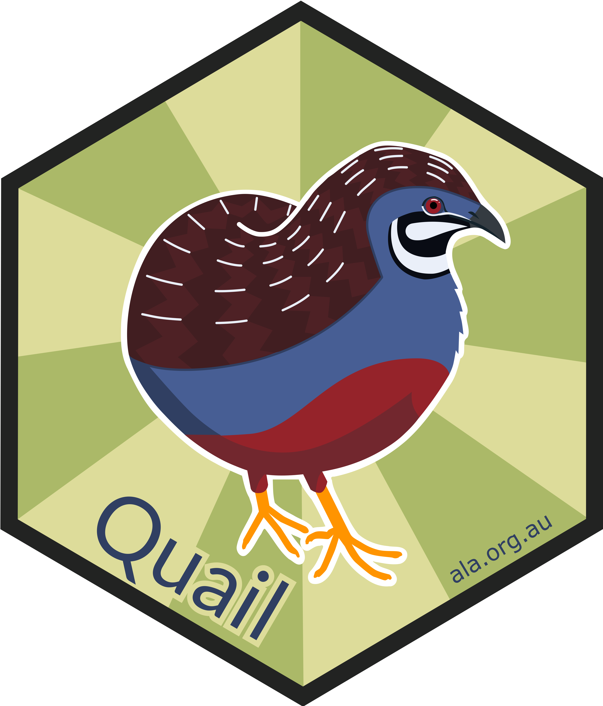
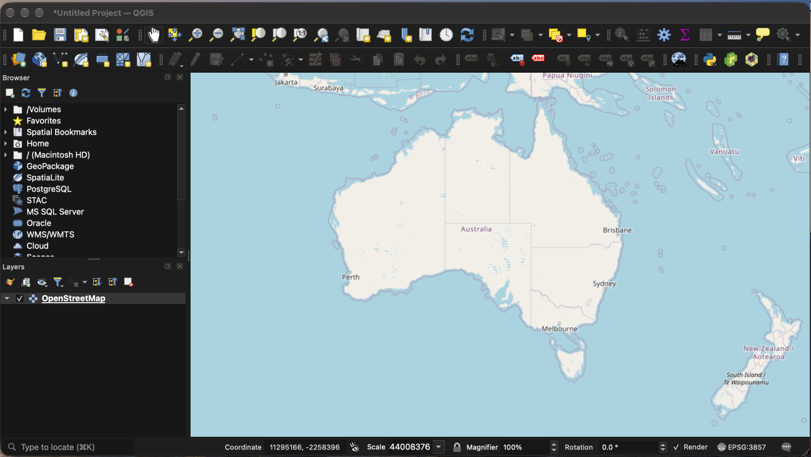
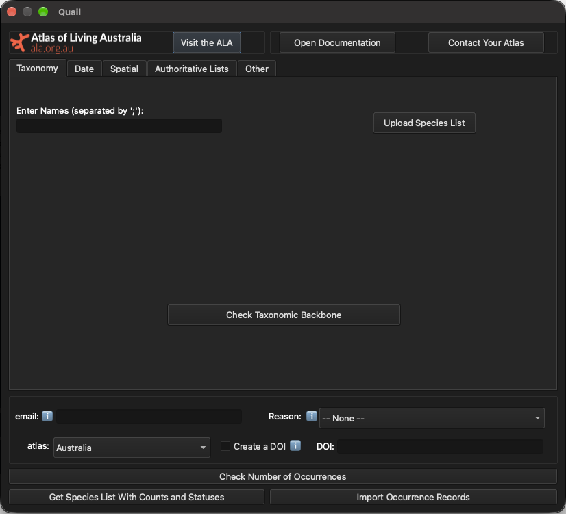
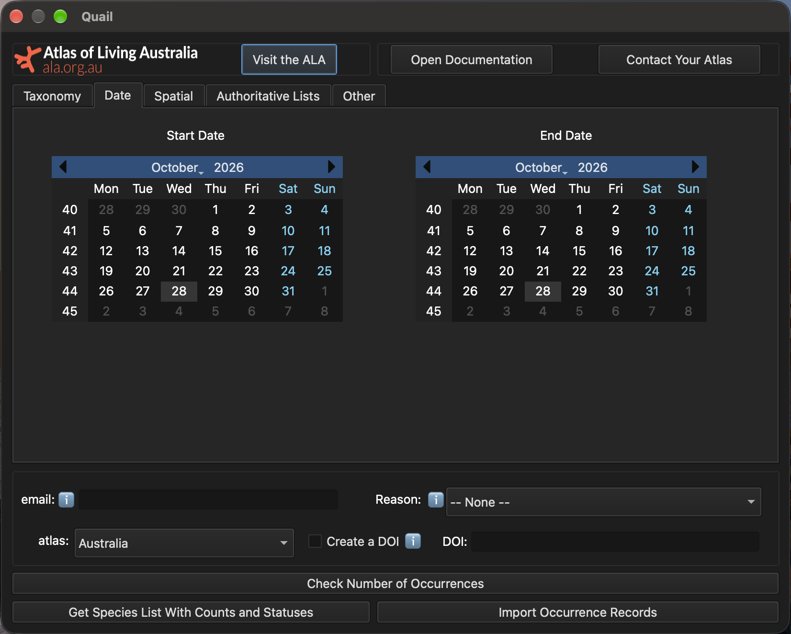
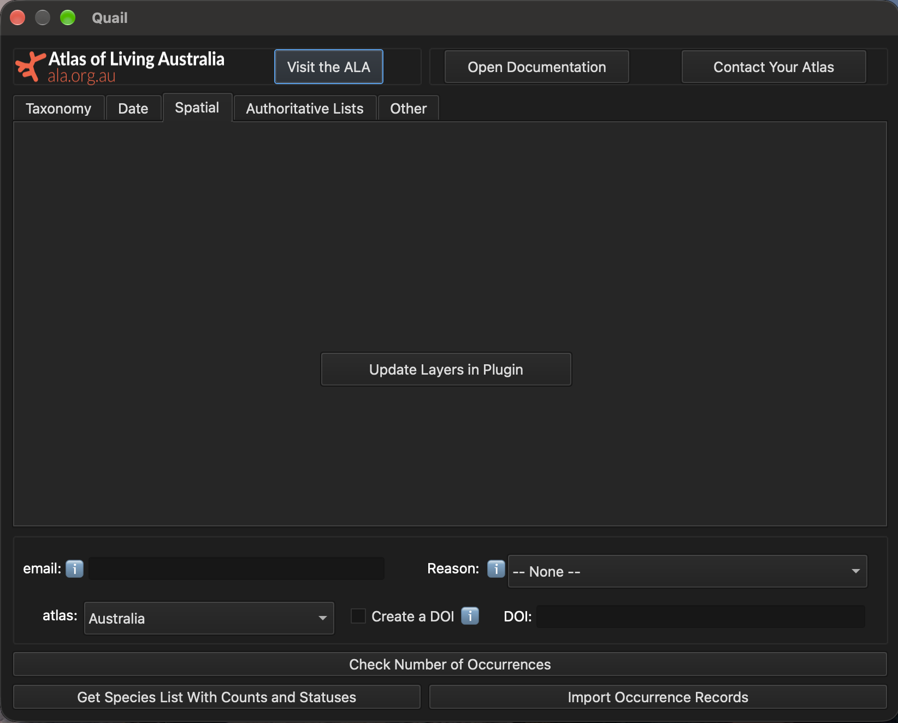
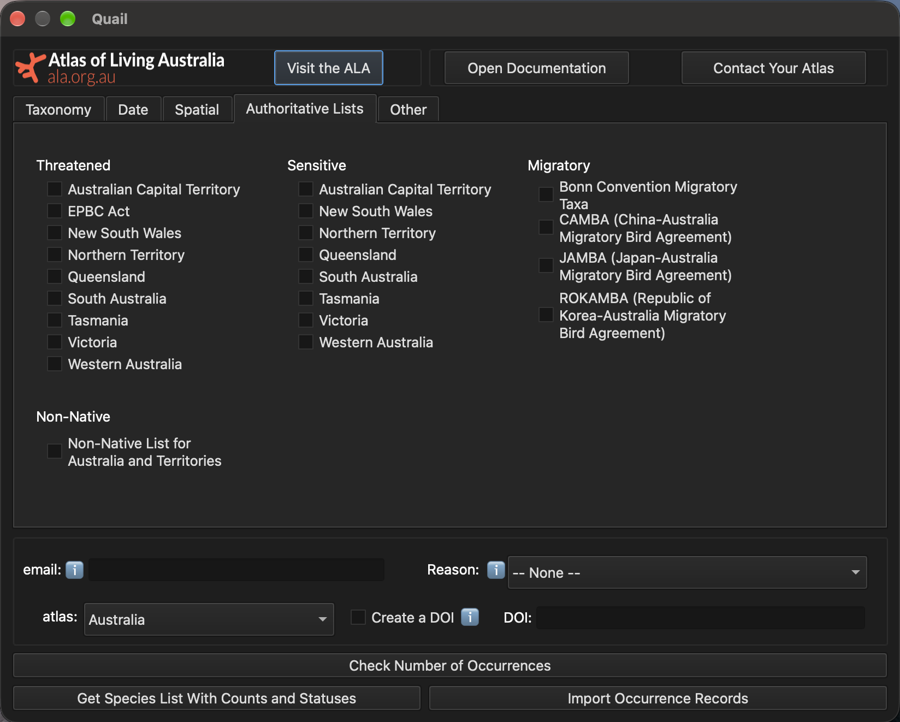
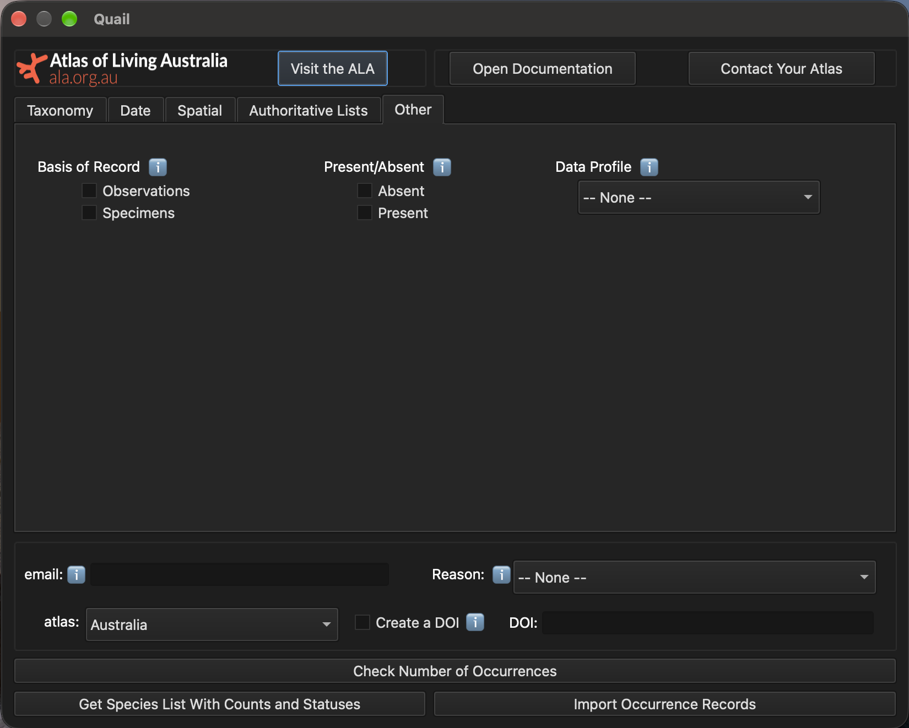

## {#title data-menu-title="Title"}
{.absolute left=550 bottom=120 width="500"}
[Quail: A QGIS Plugin for accessing biodiversity data from the Living Atlases]{.title}  
[Dr. Amanda Buyan]{.names}  

## What is QGIS? {background-gradient="linear-gradient(to bottom right, #dcdb9a, #aeb766)"}

{.absolute left=50 bottom=300 width="300" fig-cap="qgis.org"}

{.absolute left=450 bottom=60 width="1200"}

<!-- Change colours to be Quail colours -->
# How can we easily download and visualise biodiversity data into QGIS? {#cons-qn .section-break data-menu-title="Cons Question" background-gradient="linear-gradient(to bottom right, #dcdb9a, #aeb766)"}  

## There are existing plugins ... {background-gradient="linear-gradient(to bottom right, #dcdb9a, #aeb766)"}

{.absolute left=0 bottom=500 width="500"}

{.absolute left=600 bottom=500 width="500"}

{.absolute left=1200 bottom=500 width="500"}

{.absolute left=200 bottom=200 width="500"}

{.absolute left=800 bottom=200 width="500"}

## ... but they lack key features {background-gradient="linear-gradient(to bottom right, #dcdb9a, #aeb766)"}

+---------------------------------------+:----------:+:---------:+:-------:+:-------------------:+:-------------:+
|                                       | Taxonomy*  | Spatial** |  Date   | Authoritative Lists | Generate DOI  |
+---------------------------------------+------------+-----------+---------+---------------------+---------------+
|       |  &check;   | &check;   | &check; |                     |               |
+---------------------------------------+------------+-----------+---------+---------------------+---------------+
|        |  &check;   | &check;   | &check; | &check;             |               |
+---------------------------------------+------------+-----------+---------+---------------------+---------------+
|       |  &check;   |           |         |                     |               |
+---------------------------------------+------------+-----------+---------+---------------------+---------------+
|  |            | &check;   |         |                     |               |
+---------------------------------------+------------+-----------+---------+---------------------+---------------+
|                 |  &check;   | &check;   |         | &check;             |               |
+---------------------------------------+------------+-----------+---------+---------------------+---------------+

# Quail gives you more <u>key features</u> and <u>data sources</u> {#other-qn .section-break data-menu-title="Other Question" background-gradient="linear-gradient(to bottom right, #dcdb9a, #aeb766)"}  

<!-- -----------------------------------------------------
Whole and Taxa 
----------------------------------------------------- --->
## {background-gradient="linear-gradient(to bottom right, #dcdb9a, #aeb766)"}

::: {.column width="60%" .left-align}
 <!-- {.absolute left=300 bottom=50 width="900"} -->
:::

:::{.column width="40%" .right-align}
Features 

- [ ] Taxonomy 
- [ ] Date
- [ ] Spatial
- [ ] Authoritative Lists
- [ ] Generate a DOI 
:::

## {background-gradient="linear-gradient(to bottom right, #dcdb9a, #aeb766)"}

::: {.column width="60%" .left-align}
 <!-- {.absolute left=300 bottom=50 width="900"} -->
:::

:::{.column width="40%" .right-align}
Features 

- [x] Taxonomy 
- [ ] Date
- [ ] Spatial
- [ ] Authoritative Lists
- [ ] Generate a DOI 
:::







<!-- -----------------------------------------------------
Date
----------------------------------------------------- --->
## {background-gradient="linear-gradient(to bottom right, #dcdb9a, #aeb766)"}

::: {.column width="60%" .left-align}
 <!-- {.absolute left=300 bottom=50 width="900"} -->
:::

:::{.column width="40%" .right-align}
Features 

- [x] Taxonomy 
- [x] Date
- [ ] Spatial
- [ ] Authoritative Lists
- [ ] Generate a DOI 
:::

<!--  -->

<!-- -----------------------------------------------------
Spatial
----------------------------------------------------- --->

## {background-gradient="linear-gradient(to bottom right, #dcdb9a, #aeb766)"}

::: {.column width="60%" .left-align}
 <!-- {.absolute left=300 bottom=50 width="900"} -->
:::

:::{.column width="40%" .right-align}
Features 

- [x] Taxonomy 
- [x] Date
- [x] Spatial
- [ ] Authoritative Lists
- [ ] Generate a DOI 
:::

<!--  -->

<!-- -----------------------------------------------------
Authoritative Lists
----------------------------------------------------- --->

## {background-gradient="linear-gradient(to bottom right, #dcdb9a, #aeb766)"}

::: {.column width="60%" .left-align}
 <!-- {.absolute left=300 bottom=50 width="900"} -->
:::

:::{.column width="40%" .right-align}
Features 

- [x] Taxonomy 
- [x] Date
- [x] Spatial
- [x] Authoritative Lists
- [ ] Generate a DOI 
:::

<!-- -----------------------------------------------------
Other and Bonus
----------------------------------------------------- --->
## {background-gradient="linear-gradient(to bottom right, #dcdb9a, #aeb766)"}

::: {.column width="60%" .left-align}
 <!-- {.absolute left=300 bottom=50 width="900"} -->
:::

:::{.column width="40%" .right-align}
Features 

- [x] Taxonomy 
- [x] Date
- [x] Spatial
- [x] Authoritative Lists
- [ ] Generate a DOI 
:::

## {background-gradient="linear-gradient(to bottom right, #dcdb9a, #aeb766)"}

::: {.column width="60%" .left-align}
 <!-- {.absolute left=300 bottom=50 width="900"} -->
:::

:::{.column width="40%" .right-align}
Features 

- [x] Taxonomy 
- [x] Date
- [x] Spatial
- [x] Authoritative Lists
- [x] *Choose extra info
- [ ] Generate a DOI 
:::

## {background-gradient="linear-gradient(to bottom right, #dcdb9a, #aeb766)"}

::: {.column width="60%" .left-align}
 <!-- {.absolute left=300 bottom=50 width="900"} -->
:::

:::{.column width="40%" .right-align}
Features 

- [x] Taxonomy 
- [x] Date
- [x] Spatial
- [x] Authoritative Lists
- [x] *Choose extra info
- [x] Generate a DOI 
:::



## {background-gradient="linear-gradient(to bottom right, #dcdb9a, #aeb766)"}

::: {.column width="60%" .left-align}
 <!-- {.absolute left=300 bottom=50 width="900"} -->
:::

:::{.column width="40%" .right-align}
Features 

- [x] Taxonomy 
- [x] Date
- [x] Spatial
- [x] Authoritative Lists
- [x] *Choose extra info
- [x] Generate a DOI 
- [x] *Use a DOI 
:::





## {background-gradient="linear-gradient(to bottom right, #dcdb9a, #aeb766)"}

::: {.column width="60%" .left-align}
 <!-- {.absolute left=300 bottom=50 width="900"} -->
:::

:::{.column width="40%" .right-align}
Features 

- [x] Taxonomy 
- [x] Date
- [x] Spatial
- [x] Authoritative Lists
- [x] *Choose extra info
- [x] Generate a DOI 
- [x] *Use a DOI 
- [x] *Use other atlases
:::







## {background-gradient="linear-gradient(to bottom right, #dcdb9a, #aeb766)"}

::: {.column width="60%" .left-align}
 <!-- {.absolute left=300 bottom=50 width="900"} -->
:::

:::{.column width="40%" .right-align}
Getting Data 

- [x] Check Number of Records Before Download
:::

## {background-gradient="linear-gradient(to bottom right, #dcdb9a, #aeb766)"}

::: {.column width="60%" .left-align}
 <!-- {.absolute left=300 bottom=50 width="900"} -->
:::

:::{.column width="40%" .right-align}
Getting Data 

- [x] Check Number of Records Before Download
- [x] Import Occurrence Records into QGIS
:::

## {background-gradient="linear-gradient(to bottom right, #dcdb9a, #aeb766)"}

::: {.column width="60%" .left-align}
 <!-- {.absolute left=300 bottom=50 width="900"} -->
:::

:::{.column width="40%" .right-align}
Getting Data 

- [x] Check Number of Records Before Download
- [x] Import Occurrence Records Into QGIS
- [x] Get Species List With Counts and Statuses
:::

<!-- -----------------------------------------------------
Final Slide
----------------------------------------------------- --->
## {#final data-menu-title="Final" background-gradient="linear-gradient(to bottom right, #dcdb9a, #aeb766)" .final}  

::: {.column width="50%" .left-align}
   **Amanda Buyan**   Data Engineer   Atlas of Living Australia    amanda.buyan\@csiro.au    acbuyan    
:::

<!-- Add Poster number here -->
:::{.column width="40%" .right-align} 
<!-- .right-align} -->
  **Poster:** #XXXX
  **Quail documentation:**   {width=60%}   
:::